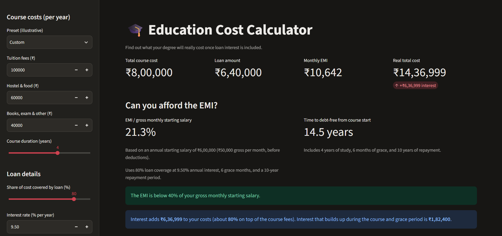

# 🎓 Education Cost Calculator

A simple web app that shows students and parents what a degree will **really** cost once education-loan interest is included, not just the fees.




## Problem statement

Students applying for an education loan usually see only the tuition and hostel fees. Interest that builds up during the course and the repayment period is rarely added up in one place, so the true cost of the degree is often much higher than expected. This project makes that total visible **before** the student borrows.

## Features

- Enter yearly tuition, hostel and other costs, and the course duration
- Choose how much of the cost the loan covers
- Includes the **moratorium period** (interest that accrues during the course and grace period)
- Calculates the monthly **EMI**, total interest, and the real total cost of education
- Checks the EMI against an expected annual starting salary using the selected loan share, interest rate, grace period, and repayment term; warns at 40% and 50% of gross monthly salary and estimates time to debt-free from the start of the course
- Charts for the cost breakdown and the loan balance over time
- Month-by-month payback table, downloadable as CSV
- Indian rupee formatting (₹12,50,000)
- Sample college presets (illustrative values only)

## How it works

| Step | Logic |
|---|---|
| 1 | Total course cost = yearly cost × years |
| 2 | Loan amount = total cost × loan share (%) |
| 3 | The loan is disbursed at the start of each academic year |
| 4 | Simple interest accrues on each disbursement until the moratorium ends |
| 5 | Accrued interest is added to the principal when repayment starts |
| 6 | EMI = P × r × (1 + r)^n / ((1 + r)^n − 1), where r is the monthly rate and n is the number of months |
| 7 | A month-by-month schedule shows interest, principal and balance |

The EMI function also handles the 0% interest case, and the calculation logic has been checked against the standard EMI formula (₹10,00,000 at 9% for 10 years gives an EMI of about ₹12,667.58).

The affordability percentage is monthly EMI divided by gross monthly starting salary. Its EMI reflects the selected loan share, annual interest rate, course plus grace-period interest, and repayment term. The debt-free estimate includes the course, grace period, and repayment period.

Run the loan and affordability scenario tests with:

```bash
python -m unittest -v
```

## Tech stack

- **Python 3**
- **Streamlit** for the web interface
- **pandas** for tables and charts

## Project structure

```
Education-Cost-Calculator/
├── app.py            # Streamlit user interface
├── loan_calc.py      # Calculation logic (EMI, moratorium interest, schedule)
├── requirements.txt  # Python dependencies
├── screenshots/      # App screenshots used in this README
└── README.md
```

## Live app

[Try the Education Cost Calculator](https://anshongit-education-cost-calculator-app-dmuke2.streamlit.app/)

## Run it locally

```bash
git clone https://github.com/anshongit/Education-Cost-Calculator.git
cd Education-Cost-Calculator

python -m venv .venv
```

Activate the environment using the command for your shell:

**PowerShell (Windows)**
```powershell
.\.venv\Scripts\Activate.ps1
```

**CMD (Windows)**
```cmd
.venv\Scripts\activate.bat
```

**Bash (macOS/Linux)**
```bash
source .venv/bin/activate
```

Then install the dependencies and start the app:

```bash
pip install -r requirements.txt
streamlit run app.py
```

After running `streamlit run app.py`, open `http://localhost:8501` in your browser.

## Author

**Ansh Kumar** — Designed, developed, and tested this project independently.

## Future scope

- Real-time fee data for colleges across India
- Compare loan offers from different banks
- Option to pay interest during the study period
- Mobile app version (Kotlin + Jetpack Compose)
- Backend with a database of colleges and courses

## Disclaimer

Preset fee values are illustrative samples, not real college fees. Results are estimates only. Please check the actual terms with your bank before taking a loan.